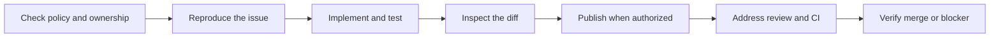

# Mangesh’s Merge Guide

A practical skill for tackling useful open-source issues and taking a fix through reproduction, implementation, testing, PR review and maintainer follow-through. It is for doing contribution work, not generating an analytics report.

The repository is `mangeshs-merge-guide`. The installed skill folder and invocation retain `oss-contribution-insights` for compatibility; the npm package is separately named `@mangeshraut712/merge-guide`. The workflow learns from accepted work, setbacks and corrections, but does not claim to guarantee acceptance.

[](https://github.com/mangeshraut712/mangeshs-merge-guide/actions)
[](LICENSE)

## November 2026 status

Verified **14 November 2026**: public, MIT-licensed source and standalone skill. This checkout targets **0.1.2**, including cache-directory validation and the documentation refresh. Confirm registry availability with `npm view @mangeshraut712/merge-guide@0.1.2 version`; [source installation](#quick-start-from-source) is also available. See [release evidence and limits](docs/results.md).

## Start here

- **First contribution:** follow [installation below](#terminal-installer), then the [beginner worked example](docs/examples.md).
- **Existing PR or expert workflow:** use the [review and native-library examples](docs/examples.md) and the [contributor playbook](skills/oss-contribution-insights/references/contributor-playbook.md).
- **What is proven:** read [validation results and limits](docs/results.md) and [three evidence-backed accepted contributions](docs/case-studies.md).
- **Need help or want to improve it:** [troubleshooting](docs/troubleshooting.md), [contributing](CONTRIBUTING.md), [security reporting](SECURITY.md), and [maintenance](docs/maintenance.md).

## Workflow at a glance



Text alternative: check policy and ownership, reproduce, fix and test, inspect the diff, publish only with authorization, address feedback, then verify the actual outcome. The diagram describes a workflow, not a promise of maintainer acceptance. See [worked examples](docs/examples.md).

## The working loop

1. **Choose useful work:** verify maintainer need, policy, ownership, duplicates and a feasible test.
2. **Reproduce:** establish the supported base, actual failure, expected contract and execution path.
3. **Fix and validate:** implement within authorized scope; demonstrate failing-before/passing-after behavior where applicable and run final-head checks.
4. **Prepare the PR:** independently inspect the diff; explain the problem, change, evidence and remaining risks. Publish only with authorization.
5. **Handle review:** map each comment to a change or reasoned response and supporting evidence. Respect authorship rules and maintainer attention.
6. **Follow through:** distinguish author-fixable issues from maintainer gates; verify acceptance or closure and learn from later corrections.

The output of a work session is a concrete patch or next step, exact validation results, unresolved feedback and the next action's owner. Historical ledgers and counts support a decision only when relevant; they are not the primary deliverable.

## Beginner to experienced contributor

The [contributor playbook](skills/oss-contribution-insights/references/contributor-playbook.md) covers first-issue setup, triage, fixes, PR preparation, review comments, respectful disagreement, blocked checks, complex changes and post-merge follow-through. Communication examples are private draft structures, never automatic messages. Expertise changes the depth of explanation, not the verification standard.

## Terminal installer

**Target release 0.1.2:** after registry publication, install using the pinned commands below. The installer has passed native Linux, macOS and Windows checks. The [source installer](#quick-start-from-source) remains available.

Use Node.js 22, 24 or 26 (the current CI matrix) and npm:

```sh
npx @mangeshraut712/merge-guide@0.1.2 install --target codex --dry-run
npx @mangeshraut712/merge-guide@0.1.2 install --target codex
```

Replace `codex` with `claude` or `cursor`. The dry run shows the destination without writing; an existing installation is refused. To keep the installation in a project, run from that project's root and add `--scope project`. The version pin makes these commands reproducible. See [installer options and safe upgrades](docs/installer.md).

These commands target release **0.1.2** and require that version to be published. [npm package](https://www.npmjs.com/package/@mangeshraut712/merge-guide) · [release validation](docs/results.md). The installer provides the skill files; your chosen agent must already be installed and configured.

### Quick start from source

**Requirements:** Node.js 20+ for the installer and a working, configured agent runtime. Git is optional (GitHub’s Download ZIP works too). Python is needed only for the optional evidence helpers. Review downloaded source first.

After obtaining this repository, run from its root in your terminal (PowerShell or a POSIX shell):

```text
node bin/merge-guide.js install --target codex --dry-run
node bin/merge-guide.js install --target codex
```

Replace `codex` with `claude` or `cursor` for that runtime. Add `--scope project` to install only in your current project. Start with the dry run: it shows the exact destination without writing. Existing files are not overwritten. See [safe upgrades and local npx](docs/installer.md).

| Runtime | User-level destination | How to use it | Verified here |
| --- | --- | --- | --- |
| Codex | `~/.agents/skills/oss-contribution-insights` | `$oss-contribution-insights` | Linux discovery and display metadata; task execution host-blocked |
| Claude Code | `~/.claude/skills/oss-contribution-insights` (or `CLAUDE_CONFIG_DIR`) | `/oss-contribution-insights` | Destination handling only; runtime discovery not tested |
| Cursor | `~/.cursor/skills/oss-contribution-insights` | `/oss-contribution-insights` in Agent chat | Destination handling only; runtime discovery not tested |

Release checks passed on native Linux, macOS and Windows runners with Node 22, 24 and 26, including packed CLI installation, file integrity, dry runs and no-overwrite behavior. This is not a promise of support in every IDE or AI platform.

## Use the skill

First obtain this public repository using GitHub’s **Code → Download ZIP**, extract it, and open a terminal in the extracted repository root. If you prefer Git and have it installed:

```sh
git clone https://github.com/mangeshraut712/mangeshs-merge-guide.git
cd mangeshs-merge-guide
```

The release checks include a fresh clone of the renamed repository. Review the files before installing.

The skill folder is [`skills/oss-contribution-insights`](skills/oss-contribution-insights). Copy that complete directory to a skills location supported by your agent. For Codex, review the files, then copy it into `~/.agents/skills/oss-contribution-insights` without overwriting an existing installation. A working, configured Codex runtime is required to execute the skill; copying files alone does not provide one.

From the repository root, this POSIX-shell example copies the complete folder and refuses an existing target, including a dangling symlink. Stop other installers before running it; it is not a concurrent installer or updater. Windows users should copy the folder using their supported installation method without overwriting an existing copy.

```sh
(
  set -eu
  source_dir="skills/oss-contribution-insights"
  target="$HOME/.agents/skills/oss-contribution-insights"
  test -f "$source_dir/SKILL.md"
  if [ -e "$target" ] || [ -L "$target" ]; then
    printf '%s\n' "Target already exists; inspect it before updating: $target" >&2
    exit 1
  fi
  mkdir -p "$HOME/.agents/skills"
  cp -R "$source_dir" "$target"
  test -f "$target/SKILL.md"
  test -f "$target/LICENSE"
)
```

Check installation, discovery and invocation separately: files present means installed; the configured runtime listing the enabled skill means discovered; a completed task using it establishes invocation. Use your Codex version's supported skill-listing interface and verify the unchanged name `oss-contribution-insights`. Optional display metadata may vary by runtime. A runtime, sandbox or sign-in error before task execution does not prove the package failed. Use supported setup/help flows; do not copy credentials or bypass security controls to make a check pass.

Invoke `$oss-contribution-insights`, for example:

> Help me tackle this issue: check its scope and existing fixes, reproduce the bug, implement and test the smallest useful change locally, then prepare a PR draft. Do not publish yet.

For an existing PR:

> Read the current review feedback, inspect the actual diff, and address the authorized changes. Report final-head test evidence and any maintainer-only gates; draft replies without sending them.

This GitHub copy is separate from any personal skill installed in ChatGPT. Updating one does not automatically update the other. This repository does not install schedules or enable access to accounts.

## C and C++ work

The [C/C++ track](skills/oss-contribution-insights/references/c-cpp-contributions.md) covers real build configurations, regression tests, ownership and undefined behavior, sanitizers, concurrency, portability and ABI compatibility. The skill is Markdown and the optional evidence helpers remain Python: no demonstrated performance or integration need justifies a native rewrite of those small JSON/network tools. No C/C++ binary or compiler validation is claimed.

## Optional evidence helpers

Python 3.10+; the optional live collector also requires an already authenticated GitHub CLI (`gh`). No third-party Python packages are required by the helpers.

```bash
python3 skills/oss-contribution-insights/scripts/ledger.py summary skills/oss-contribution-insights/assets/example-ledger.json
python3 skills/oss-contribution-insights/scripts/collect_pr_evidence.py OWNER/REPO NUMBER --output /path/to/private/new-snapshot.json
python3 -m unittest discover -s skills/oss-contribution-insights/scripts -p 'test_*.py' -v
```

The collector performs GET requests only. It records partial failures and head changes; it does not fetch repository policy, diffs or logs, verify tests, or publish anything. Offline tests use mocked responses; a green test suite is not proof of live GitHub access.

## Privacy and scope

This public package contains generic guidance, code and synthetic examples only. No personal contribution ledger, private retrospective, session history, credentials or watcher checkpoints are included. Keep collected evidence outside this checkout and review it before sharing. A PR inventory is not an inventory of every kind of GitHub contribution.

Permissions remain separate: using the skill does not authorize external messages, pushes, PRs, merges, account changes or scheduling. Respect repository AI/human-authorship policies and access denials. Do not use another identity or route to bypass restrictions.

## Open-source contributions welcome

[Open an issue](https://github.com/mangeshraut712/mangeshs-merge-guide/issues/new/choose) for a reproducible problem or scoped improvement, or [submit a pull request](https://github.com/mangeshraut712/mangeshs-merge-guide/pulls). Read [CONTRIBUTING.md](CONTRIBUTING.md) for setup, tests, review expectations and privacy guidance. Acceptance depends on usefulness, correctness and maintainer review, not activity volume.

[WhoBurnedMore](https://github.com/arhxam/whoburnedmore) is a reference for inspectable open-source tooling and clear privacy documentation, not a dependency or a token-usage goal. No code is copied from it, and this guide does not upload usage data or start background sync.

## Provenance and development

Adapted from the author's personal OSS Contribution Insights skill, with private research removed. This is an independent community project, not an official GitHub or OpenAI product. Codex Insights was a packaging example only, not the purpose or data source of this workflow.

Changes should include relevant offline tests and sourced, scoped reasoning. Do not turn a single merge into a universal success rule. Never commit real account-wide evidence as a test fixture.

## License

[MIT](LICENSE). The installable skill includes the same license notice. Contributions are welcome under the project’s existing terms.

## Project status and adoption

[Codex Insights](https://github.com/mangeshraut712/codex-insights) creates private Codex workflow reports and optional shareable aggregate profiles. These are separate skills with different installation routes.

The public snapshot retrieved **14 November 2026** records **0 stars**, **0 forks** and **195 npm downloads** for **14 October–12 November 2026**. Counts are not unique users, successful skill runs or evidence of contribution acceptance. GitHub release assets record **0 downloads**. See [the dated snapshot](docs/adoption.json), [methodology](docs/analytics.md) and [documentation index](docs/README.md).

Release 0.1.1 fixes managed upgrades after Python helpers generate bytecode. Source edits and added notes still block upgrades; the complete previous installation is retained as a backup.

Release 0.1.2 also inspects Python cache directories for added notes and symlinks while preserving valid bytecode in upgrade backups.
